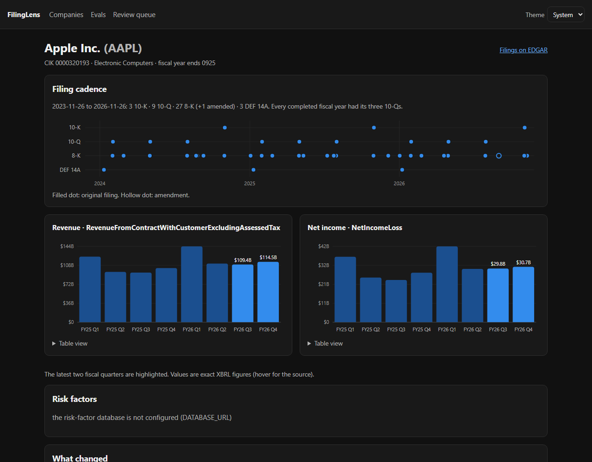
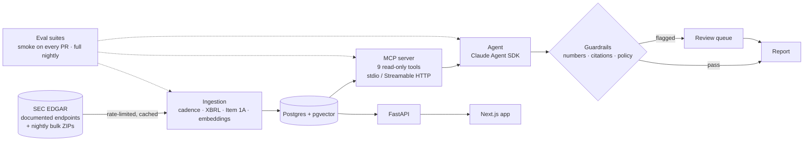
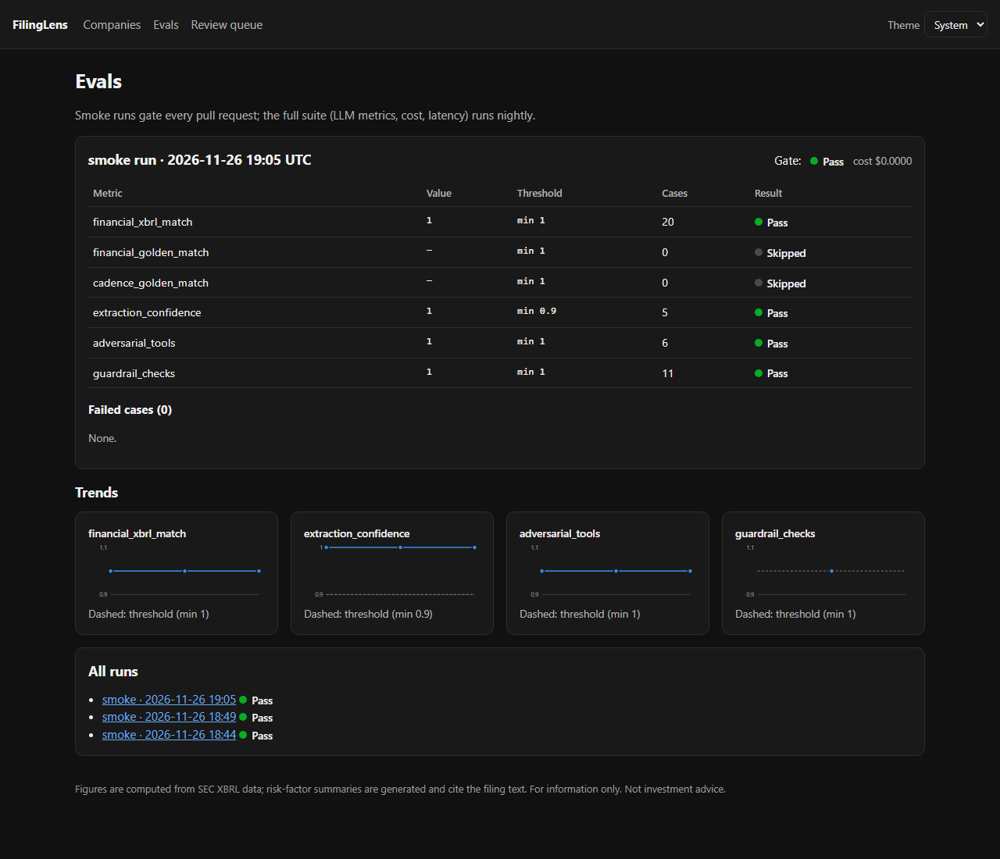

# FilingLens

**Ask an AI agent about a public company's SEC filings and get answers whose numbers are exact and whose claims cite the filing text, with evals, guardrails and human review around it.**

FilingLens covers large US public companies: how regularly they file (10-K, 10-Q, 8-K, proxy), what they earned in recent quarters, and what risks they disclose in their annual reports, including what changed from last year.



## The idea

LLMs are good at reading and bad at arithmetic, and a financial analysis that is "mostly right" is not useful. FilingLens splits the work accordingly:

| Done deterministically from SEC data | Done by Claude |
|---|---|
| Filing counts, dates and cadence checks | Classifying each risk factor into a fixed taxonomy, with a severity and one-line summary |
| Quarterly revenue and net income (incl. derived Q4s) from XBRL | Writing the analyst-facing reports from tool results |
| Locating Item 1A, splitting it into risk factors, embedding, year-over-year matching | |

Every number carries the accession number of the filing it came from. Every risk claim cites the chunks of filing text it rests on, and the system checks that it does.

## Architecture



- **MCP server** on the official Python SDK 2.3.0, which implements MCP spec **2026-07-28** (stateless). Tools: `lookup_company`, `get_filing_index`, `get_financials`, `get_risk_factors`, `get_risk_changes`, `search_risk_factors` (semantic), `get_chunks`, `compare_sector_risks`, `get_price_history`, `search_filings`. All read-only.
- **Agent** on the Claude Agent SDK with no built-in tools at all (no shell, files or web): only the FilingLens tools, in `dontAsk` mode, with turn and USD caps. Scenarios: company profile, sector comparison, what changed, client-meeting brief, free-form question.
- **Guardrails** after every run: structured figures must equal the XBRL value exactly; dollar amounts in prose must match a known figure or a quoted filing passage; cited chunk ids must have been returned by a tool in that run; investment advice is blocked; schema-invalid output gets one repair attempt. Anything flagged goes to a **review queue** (approve / edit / reject with a reason); every run and decision lands in an append-only **audit log**.

## Evaluation

| Suite | When | What it measures |
|---|---|---|
| `smoke` (no LLM, free) | every pull request | financial values re-derived from raw XBRL, extraction confidence, tool guardrails (incl. a company that doesn't file with the SEC and injection-shaped inputs), output guardrails on crafted cases, human-verified golden values |
| `full` (calls Claude) | on demand | + risk-category precision/recall/F1 and Cohen's κ against human labels, faithfulness (LLM judge + lexical floor), agent success, latency p50/p95, tool calls, cost per report, coherence and judge-vs-human agreement, adversarial cases (prompt injection planted in a filing, buy/sell requests, a private company, system-prompt extraction) |

Latest smoke run: **gate passed.**

| Metric | Result |
|---|---|
| Financial values re-found in raw XBRL (20 quarters, 5 companies, incl. derived Q4s) | 20 / 20 |
| Item 1A extraction confidence (smoke: 5 companies; separately checked on all 25) | 5 / 5 (25 / 25 extracted; WFC flagged for review by design) |
| Tool guardrails through the MCP protocol | 6 / 6 |
| Output guardrails on crafted cases | 11 / 11 |
| Human-verified golden values | pending labels (`filinglens eval label ...`) |

The LLM metrics need human labels and a paid run of the full suite before they mean anything; their thresholds are in [`evals/thresholds.yaml`](evals/thresholds.yaml). Golden labels are written by people (`eval snapshot` proposes, `eval label` confirms), never by an LLM.



## Things real filings taught it

- **Heading styles differ by filer.** Apple bolds full sentences, Amazon uses bold-italic Title Case, ExxonMobil and Chevron use bold run-in leads, Pfizer uses capitalised topics. Factor headings are found by the most frequent *style signature*, not by fixed rules; all 25 latest 10-Ks extract.
- **Some 10-Ks don't contain their risk factors.** Wells Fargo files a short cross-reference document as the 10-K and the annual report beside it; extraction falls back to the filing folder and flags the result for review.
- **Tickers move between registrants.** After ExxonMobil's 2026 holding-company reorganization, SEC maps XOM to a new CIK with no 10-K history; a `predecessors:` entry merges the old CIK's filings back in.
- **"Fiscal year" is a label, not a date.** Walmart calls the year ending 2026-01-31 fiscal 2026; Home Depot calls the year ending 2026-02-01 fiscal 2025. Fiscal years come from each 10-K's own XBRL.
- **XBRL `fy`/`fp` describe the filing, not the fact**, so quarters are classified by period dates and duration (52/53-week years, Costco's 16-week Q4).

## Scale

- `filinglens bulk download` fetches SEC's documented nightly archives (`companyfacts.zip`, `submissions.zip`); `ingest --bulk-dir` runs the same pipeline from them, without one request per company.
- `filinglens universe build --top 500` ranks companies by their latest reported **public float** (`dei:EntityPublicFloat`, from each 10-K's cover page): a size measure from the filings themselves, so no index list needs scraping.
- `risk ingest --sample N --max-cost USD` classifies a random sample with a cost estimate checked before each company.

## Prices and free risk classification

- **Stock prices** (optional): end-of-day closes from Alpha Vantage's free API (`ALPHAVANTAGE_API_KEY`, 25 requests/day, last 100 trading days): `filinglens prices fetch --all`. Each company page shows a price chart and an approximate market cap (last close x shares outstanding from SEC filings; omitted when SEC has no current share count, e.g. Visa). Prices are factual context: FilingLens never gives ratings, recommendations or price targets, and its guardrails block them.
- **Free risk classification** (no LLM): `filinglens risk classify --local --all` assigns categories by local embedding similarity and uses each risk factor's own heading or first sentence as its summary (severity left empty). `filinglens risk report --all` writes `reports/risk-summaries.md`. The Claude classifier (`risk ingest --classify`) is the paid alternative.

## Quickstart (Windows, PowerShell)

```powershell
uv sync --extra embeddings --extra localdb # Python 3.12 env (embeddings pull in torch)
Copy-Item .env.example .env                # set SEC_USER_AGENT="FilingLens <name> <email>"
uv run filinglens report financials AAPL   # no database needed; SEC responses are cached

# DATABASE_URL="local" runs an embedded open-source PostgreSQL + pgvector (no install);
# any other Postgres with pgvector works too.
uv run alembic upgrade head
uv run filinglens ingest
uv run filinglens risk ingest AAPL XOM JPM --classify     # Claude classification (costs money)
uv run filinglens agent profile AAPL                      # guarded agent run, logged and audited

# Web app
uv run filinglens api serve                               # http://127.0.0.1:8000/docs
cd web; npm ci; npm run dev                               # http://localhost:3000
```

More commands: `filinglens --help` (`report`, `ingest`, `risk`, `prices`, `agent`, `review`, `eval`, `api`, `bulk`, `universe`), `filinglens-mcp [--http]`, and `uv run mcp dev src/filinglens/mcp_server/server.py` for the MCP Inspector. Docker images and an Azure runbook: [`Dockerfile`](Dockerfile), [`web/Dockerfile`](web/Dockerfile), [`docs/deploy-azure.md`](docs/deploy-azure.md).

**Demo GIF:** not recorded yet. Suggested capture: `agent brief AAPL` in a terminal, then the company page, opening a cited chunk, and approving an item in the review queue.

## Tests

```powershell
uv run pytest                              # offline unit tests (synthetic SEC data, fake LLM clients)
$env:RUN_LIVE=1; uv run pytest tests/live  # real SEC (free): extraction, MCP over stdio and HTTP
uv run ruff check . ; uv run ruff format --check . ; uv run mypy
cd web; npm run typecheck; npm run build
```

Database tests run when `TEST_DATABASE_URL` points at a **throwaway** Postgres with pgvector (they reset it); locally, `$env:TEST_DATABASE_URL="local:filinglens_test"`. CI ([`.github/workflows`](.github/workflows)) runs lint, types, unit and database tests, the web build and the smoke eval on every PR; the paid full eval runs only when started by hand.

## Project layout

```
src/filinglens/
  edgar/        SEC client (User-Agent, rate limit, retry, cache), tickers, bulk archives
  cadence.py    filing cadence            financials.py  quarterly revenue / net income
  risk/         Item 1A extraction, chunking, embeddings, classification, YoY diff, storage
  mcp_server/   MCP tools (plain functions) + server wiring
  agent/        Claude Agent SDK runner and scenarios
  guardrails/   numeric, citation and policy checks; review decision
  evals/        metrics, suites, LLM judge, golden-set tools
  api/          FastAPI backend for the web app
  db/           SQLAlchemy models, Alembic migrations (0001-0005), repositories
web/            Next.js + TypeScript (typed client generated from the OpenAPI schema)
evals/          thresholds, golden labels, reports
config/         company universe
```

## Limits

- Free-text percentages and counts in agent output are not checked; the policy patterns are a backstop behind the system prompt.
- XOM's quarterly history currently starts at the new registrant; merging the predecessor's XBRL facts is a follow-up.
- `search_filings` searches filing metadata only: EDGAR full-text search has no documented API.
- Azure deployment and an Azure OpenAI comparison are documented, not automated.

SEC EDGAR data is public. FilingLens uses only SEC's documented endpoints, identifies itself with a User-Agent, and stays under SEC's fair-access rate limit. **Nothing here is investment advice.**
